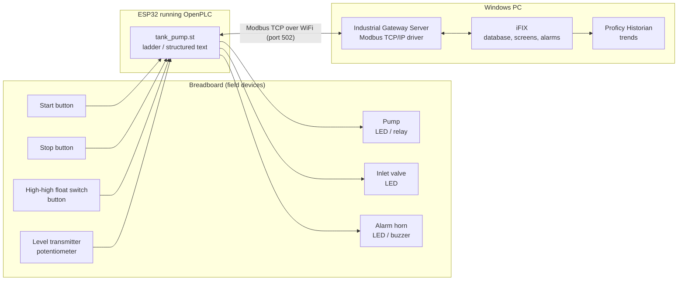
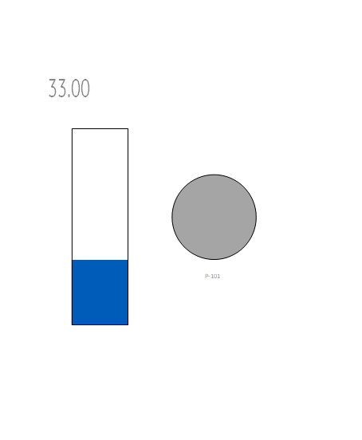
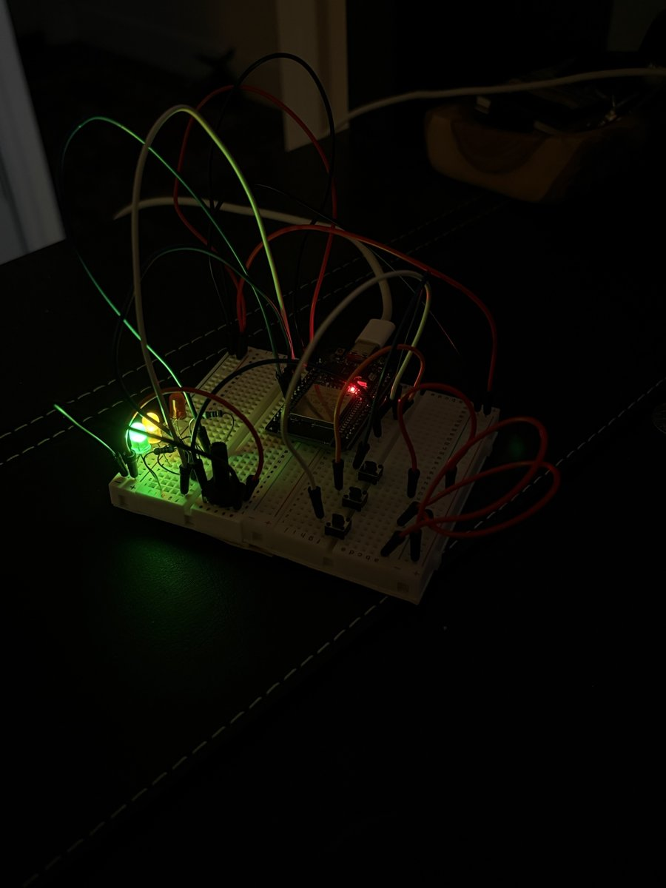
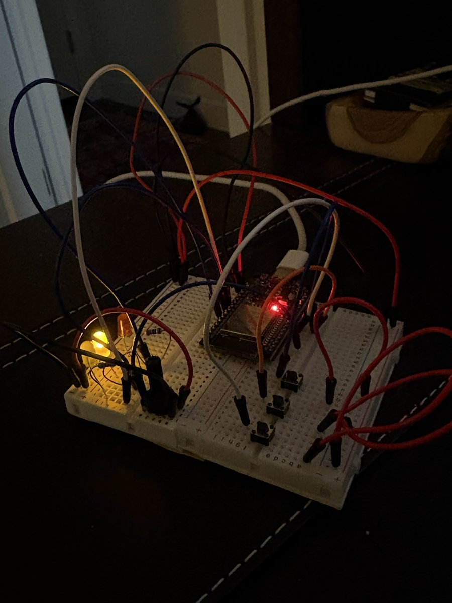
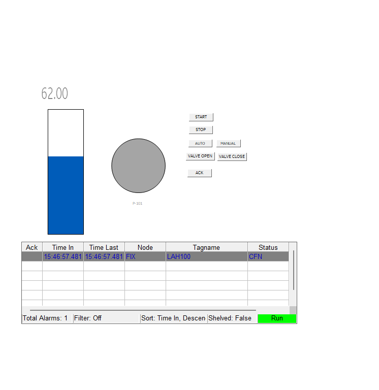
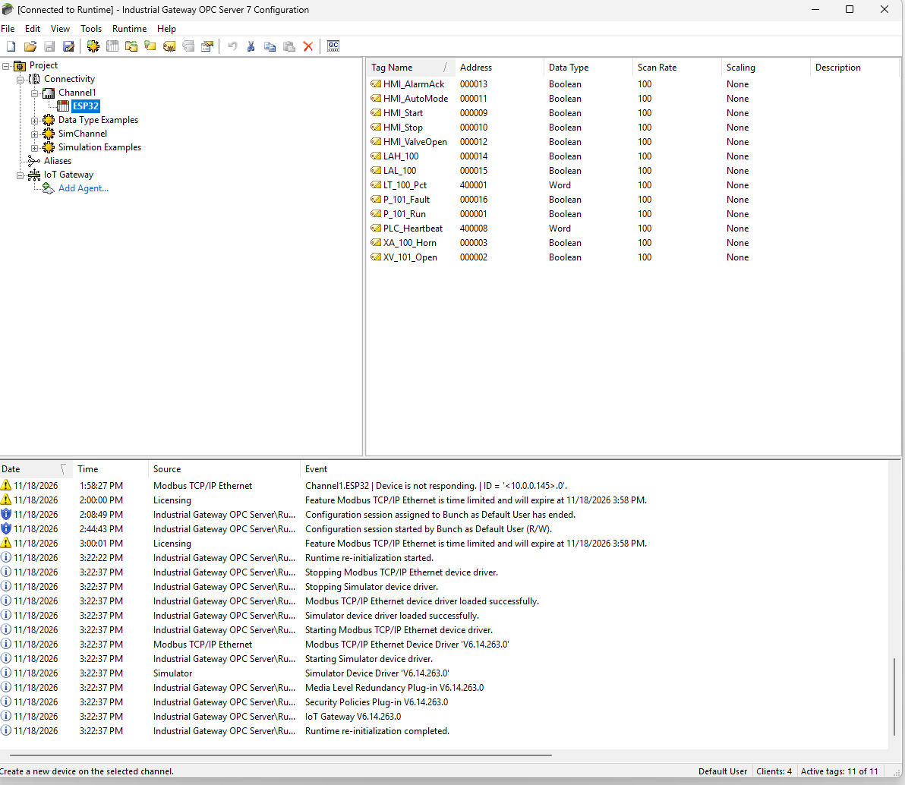
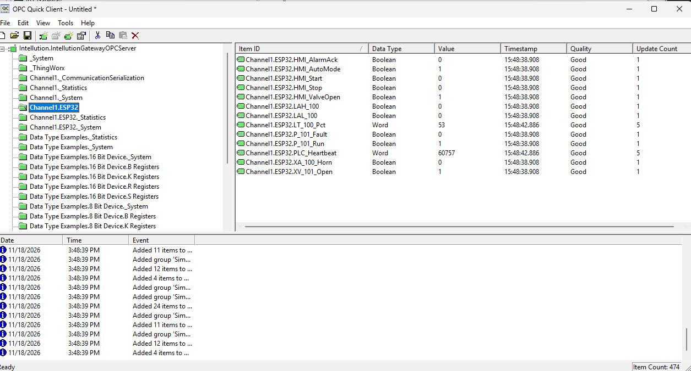
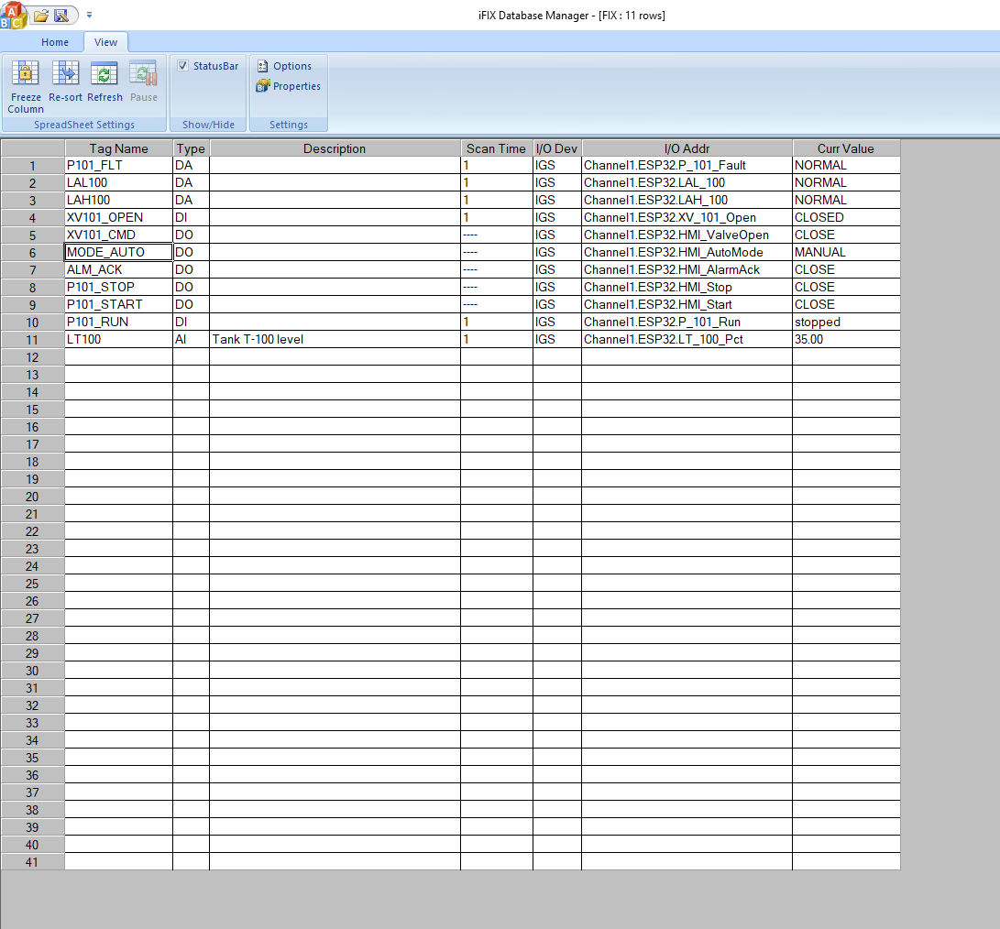

# ESP32 PLC + iFIX SCADA Lab

A practice controls system: an ESP32 running **OpenPLC** acts as the PLC, a breadboard of buttons, a potentiometer and LEDs stands in for sensors, pumps and valves, and **GE Vernova Proficy iFIX** is the SCADA layer that monitors and controls it over **Modbus TCP**.

The goal is hands-on experience with the full controls stack used by integrators: field I/O → PLC logic (IEC 61131-3) → communications driver → HMI screens, alarms and history.

## Architecture

## The process being simulated

A single tank filled by an inlet valve and emptied by a pump (a lift station, in water/wastewater terms). The PLC runs the pump between level setpoints in Auto, accepts manual start/stop in Manual, protects the pump from running dry, and raises high, low and pump-fault alarms. Full behavior is in [docs/control-narrative.md](docs/control-narrative.md).

## Photos

The breadboard "PLC" and the live iFIX screen, both driven by the same ESP32 over Modbus TCP:

| Pump running (69 %) | Filling, pump off (33 %) |
| --- | --- |
|  |  |
|  |  |

Operator controls and alarming: Start/Stop, Auto/Manual and valve commands from iFIX, with a high-level alarm (from the LSHH-100 switch) in the alarm summary:

Communications setup: the IGS Modbus TCP channel, the live tag values in the OPC Quick Client, and the iFIX process database:

| IGS tags | OPC Quick Client | iFIX database |
| --- | --- | --- |
|  |  |  |

## Repo layout

| Path | What it is |
| --- | --- |
| [docs/control-narrative.md](docs/control-narrative.md) | How the system must behave: modes, interlocks, alarms. Written like a real integrator deliverable. |
| [docs/io-map.md](docs/io-map.md) | Every tag: physical pin, PLC address, Modbus address, iFIX tag name |
| [docs/hardware.md](docs/hardware.md) | Parts list and breadboard wiring |
| [docs/setup-openplc.md](docs/setup-openplc.md) | Installing OpenPLC Editor and loading the program onto the ESP32 |
| [docs/setup-ifix.md](docs/setup-ifix.md) | Installing the iFIX trial, configuring IGS, building the database and screens |
| [docs/learning-plan.md](docs/learning-plan.md) | Week-by-week plan with milestones |
| [docs/resources.md](docs/resources.md) | Links: downloads, manuals, references |
| [plc/tank_pump.st](plc/tank_pump.st) | The PLC program in IEC 61131-3 Structured Text |
| [firmware/esp32_modbus_sim](firmware/esp32_modbus_sim) | Plain Arduino sketch that simulates the tank and serves the same Modbus map. Use it to get iFIX talking before OpenPLC is working, or with no wiring at all. |
| [tools/](tools) | Python scripts (pymodbus) to test and scan the Modbus connection |
| [scada/](scada) | Backups of the working iFIX screen and database and the IGS project, with restore steps |

## Quick start (ESP32)

1. **Arduino IDE:** install the *esp32 by Espressif* board package and the *modbus-esp8266* library (by Alexander Emelianov).
2. Open `firmware/esp32_modbus_sim/esp32_modbus_sim.ino`. In that folder, copy `secrets.h.example` to `secrets.h` and fill in your WiFi (and, optionally, a static IP). `secrets.h` is git-ignored, so your credentials never get committed.
3. Board **ESP32 Dev Module** → Upload → Serial Monitor at 115200 shows the IP address.
4. From a PC: `pip install -r tools/requirements.txt`, then `python tools/modbus_test.py <esp32-ip> --watch`.
5. Wire the breadboard ([docs/hardware.md](docs/hardware.md)), then move on to OpenPLC ([docs/setup-openplc.md](docs/setup-openplc.md)) and iFIX ([docs/setup-ifix.md](docs/setup-ifix.md)).

## Milestones

- [x] **M1 – Comms proven.** Simulator firmware on the ESP32; `tools/modbus_test.py` reads coils and registers over WiFi.
- [x] **M2 – iFIX connected.** iFIX trial installed; IGS channel/device configured; iFIX database blocks show live values from the simulator.
- [ ] **M3 – Real PLC logic.** OpenPLC program loaded on the ESP32 with the breadboard wired; logic behaves per the control narrative.
- [ ] **M4 – SCADA screens.** Tank overview screen with level, pump/valve status, Auto/Manual, start/stop, setpoint entry. *(In progress: level, pump status, Start/Stop, Auto/Manual and valve buttons done; valve status, mode feedback and setpoint entry to go.)*
- [ ] **M5 – Alarms and history.** Alarm summary, acknowledge, level trend from Proficy Historian. *(In progress: alarm summary and PLC acknowledge done; trend/Historian to go.)*
- [ ] **M6 – Rebuild the logic in Ladder.** Same program in Ladder Diagram, since most field PLCs are programmed in ladder.
- [ ] **M7 – Portfolio.** Screenshots + a 2-minute demo video; add the project to the resume.

## Notes

- The iFIX trial runs for 2 hours at a time and can be restarted.
- OpenPLC's ESP32 pin map and Modbus offsets can change between editor versions. Always confirm against the editor's board settings and with `tools/scan_registers.py` before trusting the tables in this repo.

## License

MIT — see [LICENSE](LICENSE).
